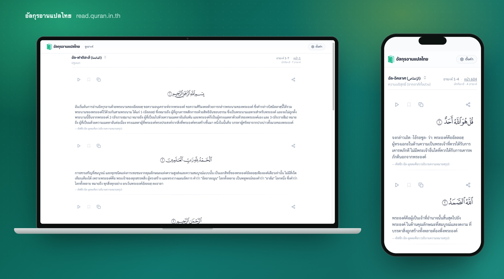

<div align="center">

# อัลกุรอานแปลไทย — Quran Web

**A modern Thai Quran reader.** Read verse by verse or page by page, listen to recitation, and follow along in Thai.

[**read.quran.in.th**](https://read.quran.in.th)



</div>

## Features

- **Verse-by-verse reading** — Arabic text with Thai translation under each ayah, for all 114 surahs
- **Mushaf mode** — page-by-page reading in the Madinah Mushaf layout, with per-page QCF glyph fonts
- **Recitation player** — pick a reciter, follow along ayah by ayah, optionally with Thai translation audio
- **Choose your translation** — switch translation source in the player and reader settings
- **Per-verse actions** — play, bookmark, copy, share, and report a translation error
- **Installable PWA** — add to the home screen; open apps are told when a new version is out
- **Thai first** — all interface text is in Thai (`@nuxtjs/i18n`)

## Part of the Open Thai Quran Project

This repo is the public reader. It sits next to three sibling repos:

| Repo | Purpose |
|------|---------|
| `quran-web` (this repo) | Public reader, Nuxt 4 SSR on Cloudflare Workers |
| `quran-api` | Hono REST API on Cloudflare Workers + D1 |
| `quran-admin` | Contributor panel for translation correction |
| `listen-quran` | Audio player at [quran.in.th](https://quran.in.th) |

The reader fetches surahs, translations and recitation data from `quran-api`; static assets (fonts, audio) are served from `assets.quran.in.th`.

## Tech stack

Nuxt 4 · Vue 3 · TypeScript · Pinia · Tailwind CSS 4 · `@nuxtjs/i18n` · `@nuxtjs/seo` · `@vite-pwa/nuxt` · Cloudflare Workers (Wrangler)

## Getting started

Requires Node.js 20+ (CI uses 24) and a running [`quran-api`](https://github.com/quran-th) for local data.

```bash
npm install

# point the reader at your API
cp .env.example .env     # defaults to http://localhost:8787

npm run dev              # http://localhost:3000
```

### Environment

| Variable | Purpose |
|----------|---------|
| `NUXT_QURAN_API_URL` | Base URL of `quran-api` (local: `http://localhost:8787`) |
| `NUXT_PUBLIC_ASSETS_BASE_URL` | CDN for fonts and audio (`https://assets.quran.in.th`) |
| `NUXT_PUBLIC_TRANSLATION_AUDIO` | Set to `false` to turn off Thai translation audio |

See [`.env.example`](.env.example) for the full list, including GitHub Actions and Cloudflare setup.

### Scripts

| Command | Description |
|---------|-------------|
| `npm run dev` | Dev server with SSR |
| `npm run build` | Production build |
| `npm run preview` | Build and run locally on the Workers runtime |
| `npm run lint` / `lint:fix` | ESLint |
| `npm run deploy` | Build and deploy with Wrangler |

## Project layout

```
app/
  pages/          /:id/:ayah? (surah reader) and /page/:pageNumber (Mushaf)
  components/     reading/, mushaf/, quran/, settings/
  stores/         Pinia stores (Quran data, recitation player)
  composables/    API client, QCF font loading
i18n/             Thai strings
server/           Nitro routes: version check, sitemap, short links
public/           icons, manifest, Mushaf page assets
```

## Deployment

Pushes to `main` run lint, then [semantic-release](https://semantic-release.gitbook.io) cuts a version and updates [`CHANGELOG.md`](CHANGELOG.md); the Cloudflare Workers deploy follows. Releases are driven by commit messages, see [CONTRIBUTING.md](CONTRIBUTING.md#commit-messages).

## Contributing

Contributions are welcome — code, translations and bug reports. Start with [CONTRIBUTING.md](CONTRIBUTING.md).

Found a wrong translation? Use the report button on the verse in the reader, or join the contributor panel (`quran-admin`).
